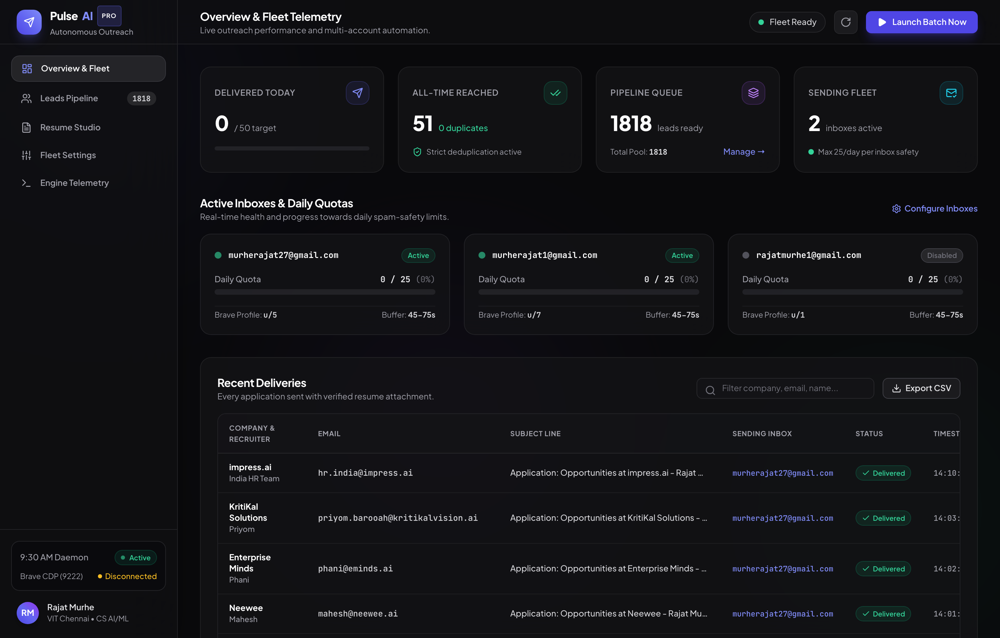
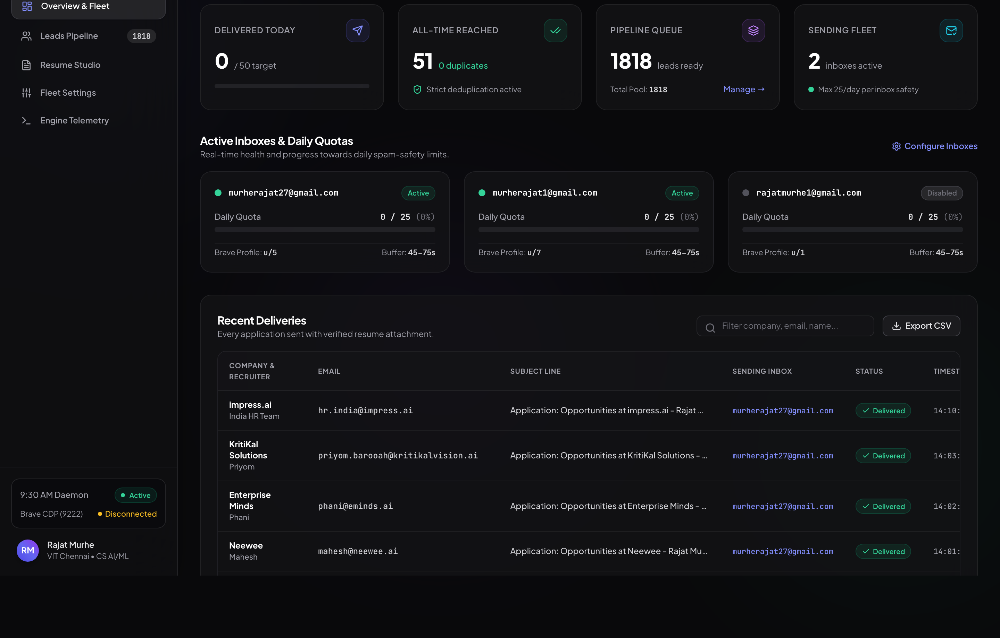
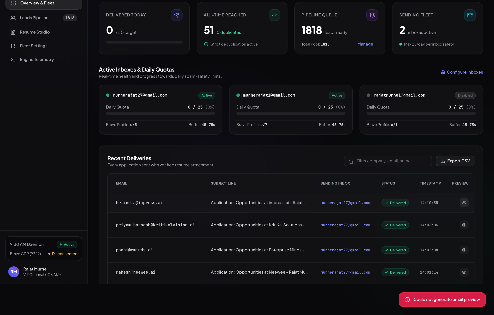

# Pulse Outreach: Autonomous Job Application & Multi-Resume Routing Platform

[](https://python.org/)
[](https://fastapi.tiangolo.com/)
[](https://brave.com/)
[](https://mail.google.com/)
[](resumes/)
[](com.rajatmurhe.outreach.plist)

**Pulse Outreach** is an autonomous, background job application and recruiter outreach platform designed to apply for **AI, Machine Learning, and Software Engineering internships** at scale. 

Unlike traditional email blast tools that use generic SMTP servers—which trigger spam filters, lack personalized attachments, or get domain-flagged—Pulse Outreach operates **directly inside real, authenticated Brave browser sessions via the Chrome DevTools Protocol (CDP)**. It sends authentic 1-to-1 emails directly through Gmail with zero focus disruption, human-like delays, customized product hooks, and an intelligent **6-resume dynamic router** that selects the ideal CV based on the target company's engineering domain.

> **Design Philosophy:** 100% independent and local. No external SaaS subscriptions, no third-party email blasters, and zero window-focus stealing while you work or code.

---

## Product Walkthrough & Screenshots

### 1. Visual Control Center & Multi-Account Quotas



The central command dashboard runs locally at `http://localhost:5050`. It tracks real-time progress across all connected sender accounts, monitors all-time vs. daily send counts, displays live Brave CDP connectivity status, and provides immediate controls to start, pause, or inspect the background daemon.

### 2. Research-Ranked Priority Lead Queue



Alphabetical outreach wastes daily quotas on generic IT staffing agencies. Pulse Outreach ingests master lead databases (1,800+ verified recruiters) and ranks them using multi-agent company research:
- **Tier 1 Elite Fit:** High-growth AI unicorns and deep-tech platforms (**SirionLabs, Roboflow, Prodigal, Recro, Claim Genius, Supervity, Ressl AI, SigNoz**) appear at the absolute top of the queue.
- **Contextual Hooks:** Injects custom 1-sentence openers connecting what each company builds to Rajat's specific flagship projects.

### 3. Live Email & Dynamic Resume Preview Modal



Before or during any batch, clicking **Preview** renders the exact message that will be delivered to that recruiter. The modal verifies:
- Recruiter first-name resolution (falling back to "Hiring Team" for generic inboxes).
- Tailored subject line prefixed with `Application: <Target_Role> Opportunities at <Company> - Rajat Murhe`.
- Context-specific body referencing matching projects.
- **Dynamic Resume Badge:** Visually confirms which specialized PDF (`Rajat-CV.pdf` for RAG/LegalTech, `Rajat-Resume.pdf` for Computer Vision, `Rajat.pdf` for Multi-Agent platforms) will be physically attached.

---

## Dynamic 6-Resume Routing Engine

Sending one generic CV to every employer lowers interview conversion. Pulse Outreach includes 6 distinct resume variants, automatically matched to the recruiter's exact role category:

| Specialized Resume | Target Role Category | Emphasized Projects & Technical Focus | Example Target Companies |
| :--- | :--- | :--- | :--- |
| [`Rajat.pdf`](Rajat.pdf) | **Agentic & GenAI Platforms** | LangGraph multi-agent workflows, MCP tool integration, CI/CD eval harnesses, DCS AI API connectors | **Shipsy**, **Pixis**, **Secomind.AI**, **Recro**, **Supervity** |
| [`Rajat-Murhe.pdf`](Rajat-Murhe.pdf) | **Voice, Conversational & Clinical AI** | ClinicVoice AI (Whisper, XTTS v2, multilingual), NeuroAI (explainable diagnostics), safety guardrails | **Suki**, **Observe.AI**, **BUDDI AI**, **Prodigal**, **Haptik** |
| [`Rajat-Resume.pdf`](Rajat-Resume.pdf) | **Computer Vision & Video AI** | FieldProof AI (Gemini video QA), RV Vision Tiny (PyTorch detector from scratch), GIoU/BCE loss, mAP evals | **Detect Technologies**, **Wobot.ai**, **Roboflow**, **Claim Genius** |
| [`Rajat-CV.pdf`](Rajat-CV.pdf) | **RAG, Document AI & LegalTech** | ContractIQ (verbatim source quote RAG, prompt defense), Linkific Enterprise RAG (pgvector + Groq) | **SirionLabs**, **Leena AI**, **Lumiq**, **Lentra** |
| [`Rajat-Murhe-Resume.pdf`](Rajat-Murhe-Resume.pdf) | **Machine Learning & Systems** | SentinelAI (Isolation Forest, Tree SHAP anomaly detection), CreditX risk classifier, telemetry | **Pelican.ai**, **bluCognition**, **SigNoz**, **Zendrive** |
| [`Rajat-Murhe-CV.pdf`](Rajat-Murhe-CV.pdf) | **Full-Stack AI & General SWE** | End-to-end full-stack AI engineering, Next.js, FastAPI, Node.js, Docker, live product deployment across 3 internships | **Trilogy**, **Dassault Systems**, **Increff**, Master Tech list |

```text
[Recruiter: SirionLabs] ────► Role: Contract Intelligence ──► Attaches: Rajat-CV.pdf
[Recruiter: Roboflow]   ────► Role: Computer Vision       ──► Attaches: Rajat-Resume.pdf
[Recruiter: Prodigal]   ────► Role: Speech Intelligence   ──► Attaches: Rajat-Murhe.pdf
[Recruiter: Recro]      ────► Role: Agentic Systems       ──► Attaches: Rajat.pdf
[Recruiter: Increff]    ────► Role: Software Engineering  ──► Attaches: Rajat-Murhe-CV.pdf
```

---

## Autonomous Execution & Browser Automation Proof

### Silent Background Tab Activation (`daily_outreach_daemon.py`)
Traditional automation tools (e.g., standard Selenium or Playwright `bring_to_front`) force window switching, stealing macOS keyboard and cursor focus. Pulse Outreach uses low-level Chrome DevTools Protocol targets:
1. **Target Discovery:** Queries `GET http://localhost:9222/json/list` to find the exact Gmail profile (`u/5` or `u/7`).
2. **Silent Activation:** Uses `Target.activateTarget` over WebSocket to unthrottle V8 background timers without bringing the macOS window to the foreground.
3. **Background Compose:** Triggers Gmail's native `Compose` action, populates recipient and subject via DOM value setters, and types the body using `document.execCommand("insertText")` to preserve formatting.
4. **File Attachment Verification:** Selects the dynamically matched PDF via `DOM.setFileInputFiles` and polls the dialog DOM until the visual attachment chip confirms the upload completed.
5. **Send & Alert Validation:** Clicks the native `Send` button and validates that the compose dialog successfully closes and the `"Message sent"` toast appears.

### Multi-Account Round-Robin & Deliverability Guardrails
- **Daily Quota Caps:** Strict 25 emails/day per sender account (total 50 emails/day across accounts). Once Account 1 reaches 25, the engine switches automatically to Account 2.
- **Human Jitter:** Delays of **45 to 75 seconds** between dispatches protect domain reputation and prevent spam traps.
- **Idempotent Deduplication:** Every dispatch is recorded immediately in `emails_sent.csv`. The engine cross-references past sent emails on every cycle—**zero duplicate applications are ever sent**.

---

## Technology Stack

| Layer | Technologies |
| :--- | :--- |
| **Browser Automation** | Brave Browser, Chrome DevTools Protocol (CDP), WebSockets, JavaScript DOM Injection |
| **Web Control Center** | Python 3.11, FastAPI, Uvicorn, HTML5, Tailwind CSS, Vanilla JavaScript |
| **Data & Queue Processing** | Pandas, OpenPyXL, CSV, JSON, Heuristic Classification & Regex |
| **Daemon & OS Integration** | macOS `launchd`, LaunchAgent Plist, AppleScript (`osascript`) Desktop Banners |
| **Quality & Verification** | Python `unittest`, Pytest, Playwright (Headless Visual Regression & Telemetry Verification) |

---

## Repository Guide

| File / Folder | Contents |
| :--- | :--- |
| [`daily_outreach_daemon.py`](daily_outreach_daemon.py) | Master autonomous daemon: CDP automation, silent Gmail dispatch, multi-account rotation |
| [`server.py`](server.py) | FastAPI backend serving dashboard APIs, live metrics, and email preview generation |
| [`build_prioritized_queue.py`](build_prioritized_queue.py) | Multi-tier queue builder: sorts leads by company AI fit, deduplicates against sent logs |
| [`config.json`](config.json) | Central configuration: accounts, daily caps, CDP port, delay ranges, and schedule |
| [`manage_daemon.sh`](manage_daemon.sh) | CLI manager: start, pause, view logs, run manual batches, install/uninstall launchd |
| [`dashboard.sh`](dashboard.sh) | Quick-launch script for the web control center on port 5050 |
| [`com.rajatmurhe.outreach.plist`](com.rajatmurhe.outreach.plist) | macOS `launchd` service definition for automated 9:30 AM weekday runs |
| [`todays_outreach_queue.csv`](todays_outreach_queue.csv) | Active queue of 1,800+ prioritized recruiter leads with tailored roles and hooks |
| [`emails_sent.csv`](emails_sent.csv) | Master log of all sent applications with timestamps, roles, and sender accounts |
| [`resumes/`](resumes/) | Directory containing all 6 specialized role-matched resume PDFs |
| [`static/`](static/) | Web assets: modern responsive dashboard UI (`index.html`, `app.js`) |
| [`docs/screenshots/`](docs/screenshots/) | High-resolution production interface screenshots used throughout documentation |

---

## Quickstart & Local Setup

### 1. Prerequisites
- macOS Sonoma or Sequoia
- Python 3.11+
- Brave Browser installed

### 2. Installation
Clone the repository and install the dependencies:
```bash
git clone git@github.com:rajatmurhe/Job-Outreach-Platform.git
cd Job-Outreach-Platform

pip install -r requirements.txt # or install fastapi uvicorn pandas websockets openpyxl
```

### 3. Launching Brave with Remote Debugging
Open Brave with CDP remote debugging active on port 9222:
```bash
/Applications/Brave\ Browser.app/Contents/MacOS/Brave\ Browser --remote-debugging-port=9222 &
```
*(Ensure you are logged into your sending accounts in user profiles `u/5` and `u/7`)*.

### 4. Running the Web Dashboard
Start the visual control center:
```bash
./dashboard.sh
```
Open [http://localhost:5050](http://localhost:5050) in your browser.

### 5. Running Outreach
- **Manual Single Batch:**
  ```bash
  ./manage_daemon.sh run-now
  ```
- **Install Scheduled Weekday Morning Daemon (09:30 AM):**
  ```bash
  ./manage_daemon.sh install
  ```
- **Inspect Live Activity Logs:**
  ```bash
  ./manage_daemon.sh logs
  ```

---

## Safeguards & Production Boundaries

1. **Strictly 1-to-1 Delivery:** Does not use BCC or CC batching. Each email is composed and delivered individually.
2. **Account Health Preservation:** Enforces a hard stop at 25 emails per account per day. Even if the queue contains 1,800 leads, daily quota ceilings cannot be breached without explicit manual config changes.
3. **Failsafe Attachment Verification:** If a resume PDF is missing or fails to upload to the compose modal within 12 seconds, the email dispatch aborts immediately and discards the draft rather than sending an empty application.
4. **Data Isolation:** All personal application logs and recruiter records remain local to your machine. No external servers or telemetry tracking are used.
